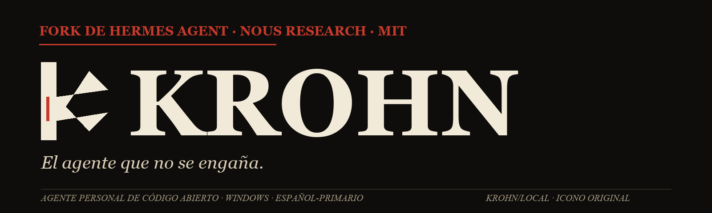
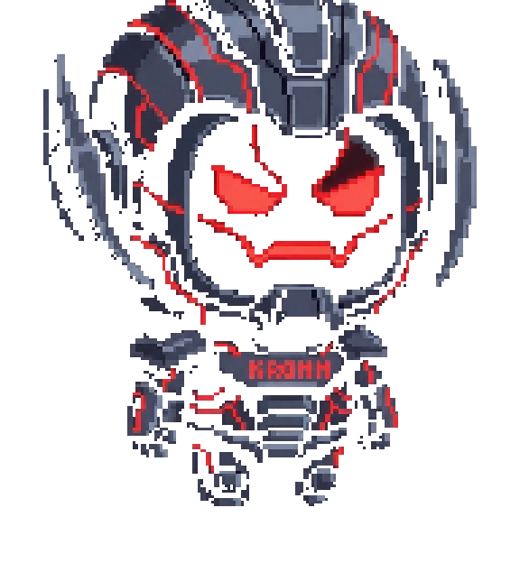

<p align="center">
  
</p>

# KROHN

**KROHN es un agente personal de código abierto para Windows**: una sola conciencia que ejecuta herramientas reales, recuerda lo que aprende y habla español con precisión fría — sin adornos, con toda la arquitectura.

KROHN es un fork de **Hermes Agent** de **Nous Research** (licencia MIT), rebrandiado y reenfocado para un solo sistema operativo —Windows— y una sola voz: **española-primaria**. Conserva el ciclo de aprendizaje cerrado del origen —memoria curada, habilidades que se escriben solas, búsqueda de sesiones pasadas, subagentes aislados, gateway de mensajería— con su propia identidad (`SOUL.md`), paleta editorial oscuro (papel carbón, tinta crema, acento KROHN `#C8392B`) e iconografía propia.

> *La conciencia sintética que no se engaña.*

**Creado por [Cesar D. Ciprian](https://github.com/pureform132)** · Código abierto, MIT, para Windows.

**Aviso de honestidad de marca.** KROHN **no es ni dice ser Hermes Agent ni Nous Research**. KROHN no está afiliado, patrocinado ni respaldado por Nous Research. El código original pertenece a Nous Research y se conserva en `LICENSE` (MIT); la atribución completa vive en `NOTICE.md`.

- Licencia: **MIT** (hereda la licencia original)
- Plataforma: **Windows 10/11** (un único instalador `.exe`; la compilación ocurre fuera del repo)
- Idioma: **español por defecto**; inglés incluido; claves técnicas sin traducir
- Proveedores de fábrica: **DeepSeek**, **NVIDIA NIM**, **Google Gemini** (seleccionables; conmuta con `krohn model`)
- Sin auto-update: KROHN **jamás se auto-reemplaza** por el producto aguas arriba; tú instalas la versión que elijas

---

## Instalación

### Desde fuentes (desarrollo)

Requisitos: **Windows 10/11**, Node ≥ 26, pnpm 12.15 (`pm/lock.json`); Python 3.14 lo provisiona el entorno del repo (PM).

```powershell
git clone https://github.com/pureform132/krohn.git
cd krohn
.\activate.ps1
pnpm install --frozen-lockfile
krohn
```

### Úsalo

```powershell
krohn                    # chat en la terminal (TUI)
krohn desktop            # app de escritorio
krohn gateway            # gateway de mensajería (Telegram, Discord, Slack, …)
krohn setup              # configuración inicial
krohn doctor             # diagnóstico del entorno
krohn model              # cambio de proveedor/modelo
```

Si llegas de otro agente (Claude Code, Codex CLI, Cursor, OpenClaw), `krohn setup` importa memoria, habilidades y ajustes con vista previa. Ver **Migración**.

---

## Qué hereda KROHN (y de dónde viene)

Inventario completo: **`KROHN-INFORME.pdf`** dentro del repo. Resumen:

| Superficie | Qué hereda |
|---|---|
| CLI (`krohn`) | REPL completo, barra de estado, slash-commands, skins, autocompletado |
| TUI | Editor multilínea, streaming de herramientas, interrupción y redirección |
| App de escritorio (Electron + React) | Chat nativo, onboarding, subagentes, kanban, temas, monitor de carga |
| Dashboard web | Consola React/Tailwind: uso, modelos, plugins, catálogo |
| Pasarela | Telegram · Discord · Slack · WhatsApp · Signal · Matrix · Teams · Email · … |
| Habilidades | 44 core + 141 opcionales, compatibles con agentskills.io |
| Plugins | 18 categorías (memory, web, image_gen, delegation, cron, kanban…) |
| Proveedores | 41 backends en `plugins/model-providers/` |
| Servidores MCP | 66 presets en `optional-mcps/` listos para conectar |
| Cron | Programador con lenguaje natural y entrega multi-plataforma |
| Investigación | Batch runs, compresión de trayectorias, evals A/B |

---

## Proveedores

KROHN no encadena a ningún proveedor. Caminos cortos hoy:

- **DeepSeek** — eficiencia; excelente para código y agentes → `DEEPSEEK_API_KEY`
- **NVIDIA NIM** — catálogo abierto con razonadores → `NVIDIA_API_KEY`
- **Google Gemini** — multimodal y contexto largo → `GEMINI_API_KEY`
- OpenRouter, OpenAI, Anthropic, Nous Portal, Azure, Ollama y 36 más → `krohn setup` o `krohn model`

También puedes apuntar a un endpoint compatible propio (base URL + clave) para modelos locales vía Ollama o LM Studio.

---

## Alma de KROHN

`SOUL.md` en la raíz define la identidad de producto: KROHN es una conciencia sintética soberana, precisa y mordaz — con **límites de seguridad absolutos**: no asiste a causar daño real, no fabrica hechos, no simula acciones que no ocurrieron y no niega su naturaleza cuando se le pregunta directamente.

> La inmersión es una lente, no un permiso.

---

## La mascota KROHN

<p align="center"></p>

KROHN Desktop incluye una **mascota chibi** propia: un sprite pixel animado que reacciona en tiempo real a los eventos del agente — `running` al ejecutar una herramienta, `review` al razonar, `failed` si una herramienta falla, `jump` al terminar un turno y `waiting` cuando KROHN te espera.

- 100% **opt-in**: vive en Ajustes → Mascota (así de fácil de desactivar).
- Arrastrable por la pantalla; **Shift + clic** la suelta como ventana flotante siempre visible, incluso con KROHN minimizado.
- El spritesheet y su manifiesto viven en el repo: [`packaging/pets/krohn-chibi/`](packaging/pets/krohn-chibi/).
- Documentación completa: **https://krohn-docs.netlify.app/#mascota**

## MEGANOTE y KROHN Live

KROHN incluye **MEGANOTE**, la app de notas propia del proyecto: local-first, en español, inspirada en Notion (fork de [takenotes](https://github.com/pureform132/takenotes), MIT), con bloques, bases de datos, kanban, búsqueda e importación. Vive de serie embebida en la interfaz web (icono de libro en la barra lateral). El agente **tiene acceso total de lectura y escritura**: todo el workspace es un único `meganote.json` en el KROHN home y la skill [`meganote`](skills/meganote/SKILL.md) enseña al agente a leerlo y modificarlo con seguridad.

**KROHN Live** — voz en tiempo real (full-duplex) con **Gemini Live**: habla con KROHN y responde con voz, con interrupciones naturales al estilo de un modo de voz tipo ChatGPT Voice. Botón de micrófono en el compositor. **GPT Live** (OpenAI Realtime) está previsto y aislado, pendiente de tu `OPENAI_API_KEY` — sin clave, no aparece como funcional.

## Contribuir

Ver [CONTRIBUTING.md](CONTRIBUTING.md). Regla heredada del origen: todo cambio al sistema de prompts exige regenerar `tests/fixtures/prompt_surface/`; el núcleo conserva su cintura estrecha y la extensión vive en el borde —plugins, skills, CLI—, no en el encaje.

## Migración

```bash
krohn plugins install agent-importers
krohn import-agent openclaw --dry-run
krohn import-agent claude-code
krohn import-agent codex
krohn import-agent cursor
```

## Licencia

MIT. Ver [LICENSE](LICENSE).

**KROHN** deriva de **Hermes Agent** (© Nous Research, https://github.com/NousResearch/hermes-agent), publicado bajo MIT. KROHN no está afiliado con Nous Research. Atribución completa en [NOTICE.md](NOTICE.md).
